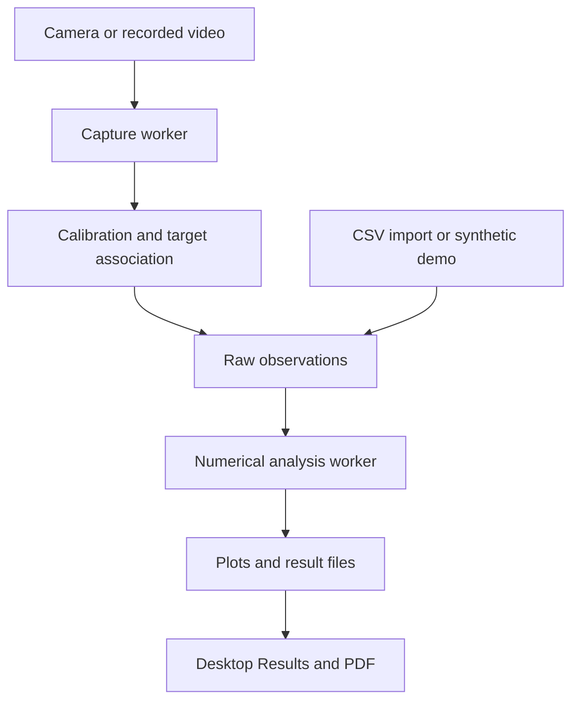

# Architecture and maintenance

## Layout

| Module | Responsibility |
|---|---|
| `engine.py` | Pure numerical analysis. Accepts a DataFrame and immutable settings; returns observations, models, statistics, and warnings. No GUI/camera/ML imports. |
| `calibration.py` | Validated two-point spatial scale and source-frame coordinate conversion. |
| `tracking.py` | Single-target association, explicit selection, ambiguity/loss handling, and continuity identifiers. |
| `detection.py` | Color-marker segmentation and optional YOLO adapter. Heavy imports occur only when needed. |
| `capture.py` | Worker-owned OpenCV source access, media timing, command queue, detection, sample generation, and capture diagnostics. |
| `data_io.py` | Strict UTF-8 local CSV import, shared by GUI and CLI. |
| `output.py` | Noninteractive plots, PDF, CSV, JSON, text summary, and file checksums. |
| `export_worker.py` | Spawned report renderer and transactional publication of finished exports. |
| `gui.py` | Native Qt widgets, source/setup/result state, asynchronous import/analysis, and graceful shutdown. |
| `cli.py` | Camera-free analysis/demo, diagnostics, and machine-readable CLI output. |
| `launch.py` | Optional project-local virtual environment setup and platform-independent launch. |

## Data flow

The acquisition worker owns its video source and detector. The GUI only queues commands and consumes Qt signals. It never calls OpenCV capture methods on the main thread. Source images are copied into owned `QImage` buffers before emission.

A file waits on its first decoded frame until setup is ready. Once tracking starts, its source clock comes from media timestamps or an explicitly flagged nominal-FPS fallback. Webcam time is sampled after acquisition. Worker selection/stop/start commands are consumed in order. An acquired frame already being inferred can complete before a queued Stop is applied; all accepted samples are emitted exactly once on completion. A Stop queued during model loading prevents a new inference from starting afterward.

The capture metadata snapshot records source type, dimensions, FPS when known, processed/accepted/missed counts, timing methods, finish reason, and warnings. Recording completion freezes that snapshot so continued webcam preview cannot modify the saved run's counts. A resolution change ends the run before applying old calibration to the new image.

## Desktop state

Source setup, calibration, target selection, tracking, stopping, import, and analysis have explicit UI states. Buttons and editable fields reflect the state; starting a new source or changing numerical settings clears stale plots/report links. File end triggers analysis without requiring a Stop click. Failed analysis retains observations for retry.

Capture, CSV import, and numerical orchestration run in separate `QThread` instances. The GUI exports reports in a fresh spawned process; an abnormal native renderer exit becomes a recoverable error and does not terminate the desktop process. Widgets and `QPixmap` remain on the main Qt thread. Signals update the interface. Closing waits asynchronously for active operations; workers are not forcibly terminated, and the window does not block on a long `wait()` call. This follows the ownership and queued-signal principles in the [Qt QThread documentation](https://doc.qt.io/qtforpython-6/PySide6/QtCore/QThread.html).

The capture worker may pause a file on an ambiguous frame so the operator can select a target. A camera continues acquiring in real time. Neither mode fabricates observations during missing detections. Manual reselection or lost-target reacquisition establishes a new track identifier.

## Numerical and export boundaries

`AnalysisSettings` is frozen and validated before processing. The engine copies input observations, preserves their extra metadata, and never mutates a caller's DataFrame. Required numeric columns are validated without silently coercing malformed values into usable measurements. Derived values are separate columns with explicit units.

No fit crosses a time-gap or `TrackID` boundary. A bounce candidate can further divide a continuous free-fall interval. Small intervals retain their measured positions but have blank derivatives. The coefficient and uncertainty contracts are documented in [methodology](methodology.md).

Matplotlib uses the noninteractive Agg backend, with no Qt canvas. For the GUI, the isolated renderer writes into parent-owned temporary staging; a finished run is published only after the child exits successfully, with cleanup if rendering fails. The camera-free CLI uses the same exporter directly. Figure/PDF creation is serialized inside each process because Matplotlib and font registration contain global state. Plot lines are drawn one interval at a time. The PDF uses a Unicode font already shipped by the Matplotlib dependency. External text is escaped and wrapped before entering ReportLab paragraphs.

A result folder is exclusively created with a UTC timestamp and random suffix. The exporter writes a manifest last and removes its own partial folder if export fails. JSON disallows NaN/Infinity. The original observations remain available to the caller for retry. The manifest verifies file integrity, not scientific validity or authorship.

## Development conventions

- Add a regression with known input/output when fixing a mathematical, timing, or state bug.
- Keep GUI/camera dependencies out of the engine and CLI's offline analysis path.
- Use real timestamp units; never substitute inference wall time for a video file's media time.
- Preserve observations and uncertainty/assumption labels. Do not fill missing detections silently.
- Keep visible copy about the current task. There are no promotional sections, decorative badges, or generated interface art.
- Keep report/schema changes synchronized with methodology and tests. Version 2 coefficients differ from version 1.
- Treat downloaded ML models as executable/trusted inputs. Do not load arbitrary untrusted weights.

## Tests

Core tests cover numerical ground truth, input validation, calibration, strict import, plotting, export cleanup, and CLI behavior. Optional desktop tests use offscreen native Qt and generated OpenCV video frames. Synthetic media tests exercise the actual decoder and detector; tests inject controlled dependencies only for conditions such as camera failures or a model load that must be interrupted.

A physical webcam, OS camera permission dialog, real YOLO model, and GPU driver each require additional validation on the target computer. The automated suite does not substitute for those hardware checks.
